<p align="center">
  
</p>

<h1 align="center">VISUAL REFERENCE INTELLIGENCE</h1>

<p align="center">
  <strong>Engenharia reversa visual · Reprodução 1:1 · Validação pixel-perfect</strong>
</p>

<p align="center">
  <a href="https://github.com/pedrohen-lopes/VISUAL-REFERENCE-INTELLIGENCE/actions/workflows/ci.yml">
    
  </a>
  <a href="https://github.com/pedrohen-lopes/VISUAL-REFERENCE-INTELLIGENCE/blob/main/LICENSE">
    
  </a>
  <a href="https://github.com/pedrohen-lopes/VISUAL-REFERENCE-INTELLIGENCE/releases">
    
  </a>
  
  
</p>

---

## 🎯 O que é

O **VRI** transforma o Claude (Project ou Code) em um **especialista em engenharia reversa visual**. Você envia screenshots, mockups, fotos de tela ou vídeos; ele **analisa forensemente, documenta com rastreabilidade total, implementa só com sua autorização explícita e valida pixel-a-pixel**.

> **Não é um gerador de sites.** É um **reprodutor fiel**. A fidelidade à referência é o único critério de sucesso.

---

## 🔄 Fluxo completo

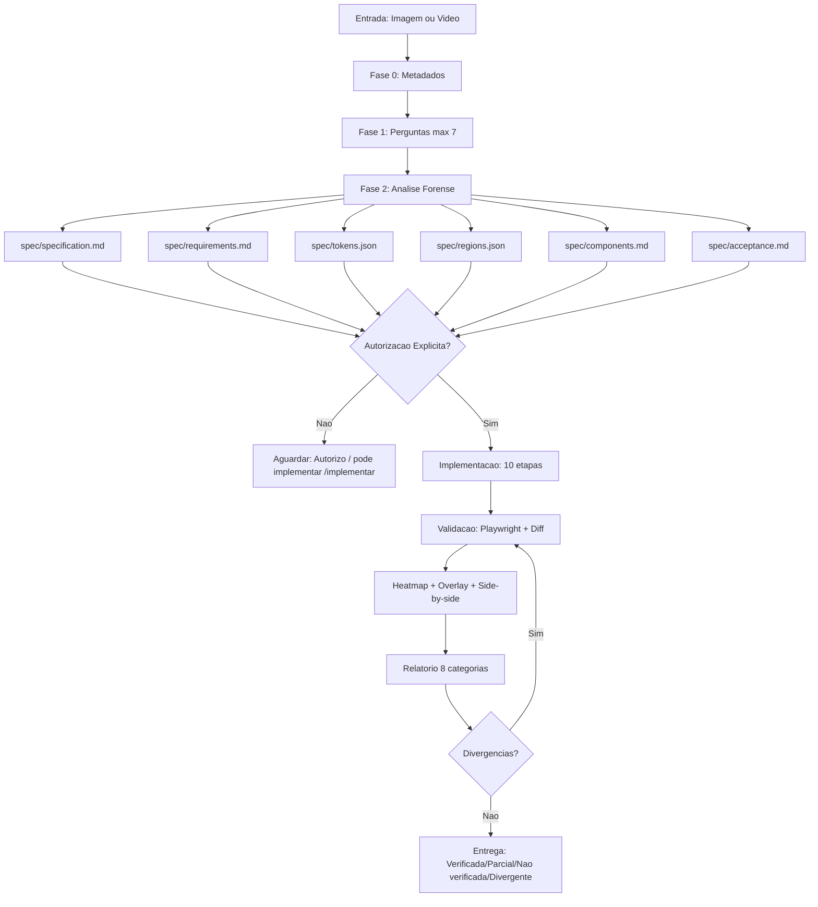

---

## 🔍 O que a validação produz (artefatos reais)

| Artefato | Descrição | Exemplo |
|----------|-----------|---------|
| **Heatmap** | Vermelho = pixels divergentes (tolerância ±8/255 por canal) |  |
| **Overlay** | Referência + resultado com 50% transparência cada |  |
| **Side-by-side** | Referência \| Resultado para inspeção visual direta |  |
| **Regiões marcadas** | Áreas nomeadas com labels (A_header, B_hero, C_cards, D_footer) |  |
| **report.json** | % divergência total, por região, SSIM, bounding box das diferenças | [Ver JSON](docs/diff-example/report.json) |

> **Exemplo real:** `landing_ref.png` vs `landing_result.png` — 3 diferenças plantadas detectadas na região `B_hero` (2.34% divergente): botão 6px abaixo, verde `#388E3C` vs `#2E7D32`, "Cidade" com C maiúsculo.

---

## 📦 Duas formas de usar

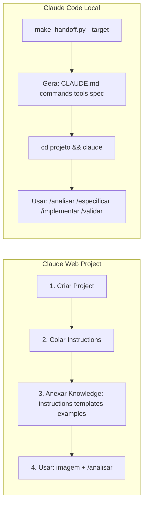

---

## 🌐 Guia visual: Instalação no Claude Project (Web) — 2 min

### Passo 1: Criar Project novo


### Passo 2: Colar Instruções
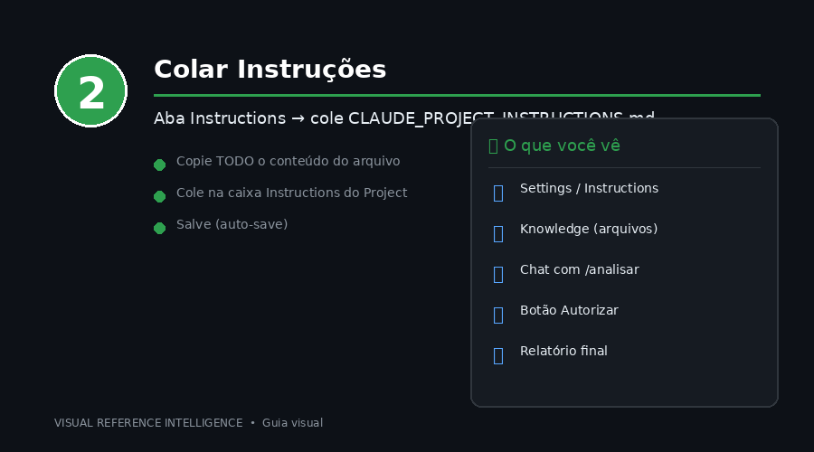

### Passo 3: Anexar Knowledge (3 pastas)
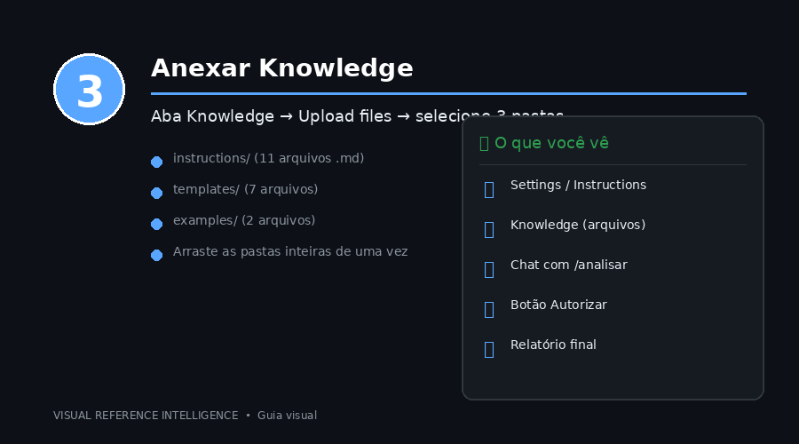

### Passo 4: Usar — anexar imagem + /analisar
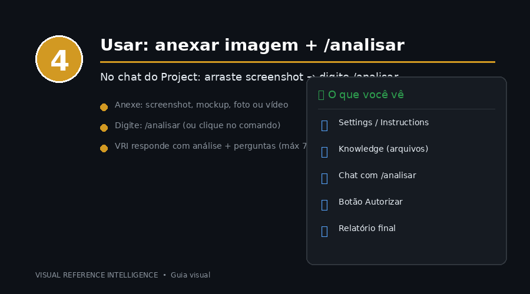

### Passo 5: Fluxo completo — responder → /especificar → Autorizar → /implementar → /validar
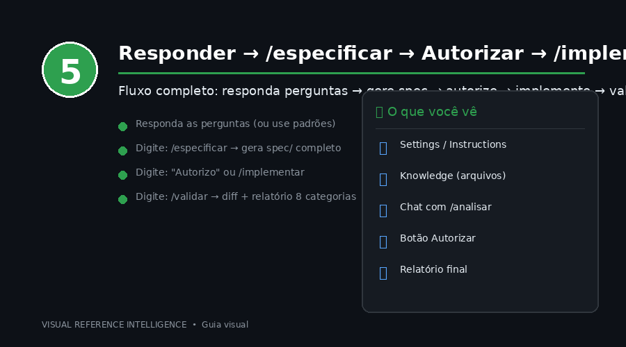

> **O que vai no Knowledge:** `instructions/` (11 .md), `templates/` (7), `examples/` (2)  
> **NÃO precisa:** `tools/`, `tests/`, `claude-code-handoff/` (são para uso local)

---

## 💻 Guia visual: Uso com Claude Code (Local)

### Passo 1: Gerar handoff na pasta do seu projeto
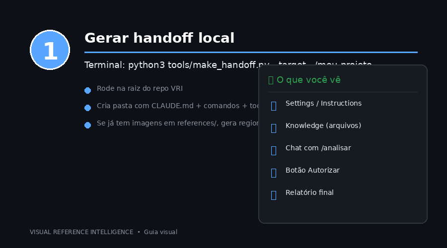

```bash
# Na raiz do repo VRI
python3 tools/make_handoff.py --target ../meu-projeto-real
```

### Passo 2: Abrir Claude Code na pasta
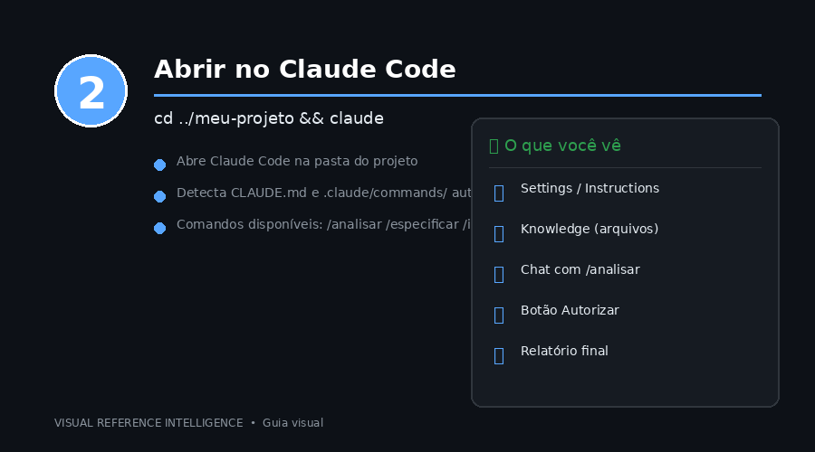

```bash
cd ../meu-projeto-real && claude
```

### Passo 3: Colar referências + /analisar
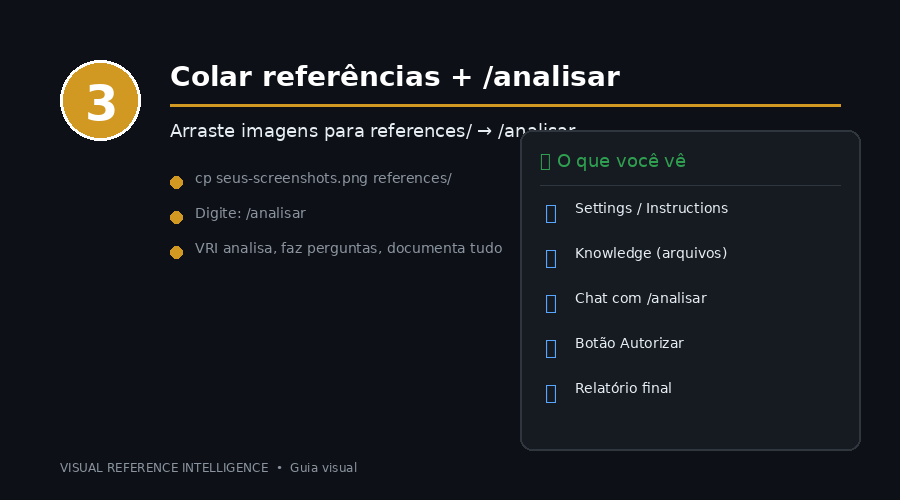

```bash
cp seus-screenshots.png references/
# No Claude Code:
/analisar
```

### Passo 4: Autorizar + /implementar + /validar
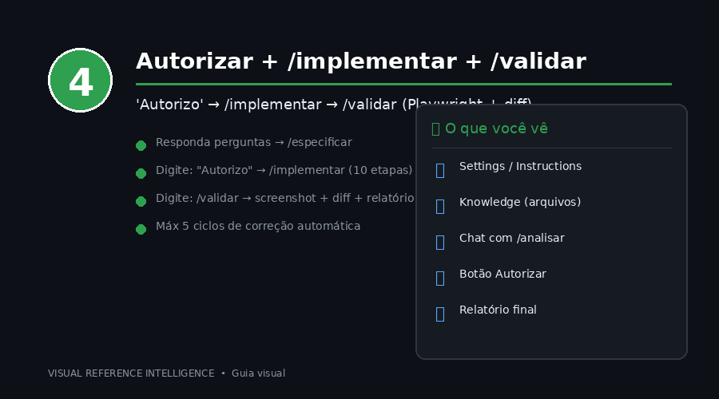

```bash
# No Claude Code:
/especificar
Autorizo
/implementar
/validar
```

---

## 🔧 10 Etapas de implementação (ordem fixa, validada)

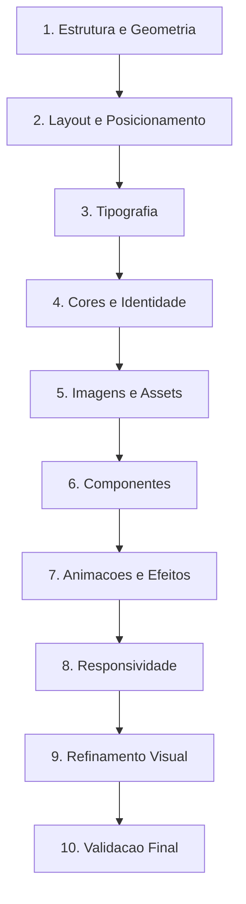

> Cada etapa só avança quando a anterior passa na validação visual. **Nenhum atalho.**

---

## 🏷️ Sistema de tags (rastreabilidade obrigatória)

Toda medida, cor, fonte e decisão carrega **tag + confiança**:

| Tag | Significado | Quando usar | Exemplo |
|-----|-------------|-------------|---------|
| `[OBSERVADO]` | Medido direto na imagem nítida | Imagem clara, @1x, elemento visível | `raio: 12px [OBSERVADO] ALTA` |
| `[ESTIMADO]` | Medido com margem declarada | Imagem comprimida, @2x/@3x, redimensionada | `cor: #2E7D32 [ESTIMADO] ±3 MÉDIA` |
| `[HIPÓTESE]` | Não visível, deduzido logicamente | Hover, focus, animação, estado loading | `hover: scale(1.02) [HIPÓTESE] BAIXA` |
| `[DESCONHECIDA]` | Zero evidência | Imagem estática, área cortada, fora do frame | `animação de entrada [DESCONHECIDA]` |
| `[INFERIDA]` | Estrutura técnica deduzida | HTML/JS, hierarquia de componentes, grid | `componente: Button [INFERIDA] MÉDIA` |
| `[COMPROVADA]` | Confirmada por evidência direta | DevTools, Figma, arquivo original, código-fonte | `fonte: Inter [COMPROVADA] ALTA` |

**Escala de confiança**: 🟢 **ALTA** ≥ 90% · 🟡 **MÉDIA** 60–89% · 🔴 **BAIXA** < 60%

---

## 📊 Avaliação final — 8 categorias, sem notas arbitrárias


| Status | Significado |
|--------|-------------|
| ✅ **Verificada** | Passa nos limiares de aceitação com evidência |
| ⚠️ **Parcialmente verificada** | Passa em parte, com lacunas documentadas |
| ❓ **Não verificada** | Sem evidência para validar (ex.: responsividade sem breakpoints) |
| 🔴 **Divergente** | Falha nos limiares — requer correção |

> Cada categoria traz: **evidências + pendências**. **Sem notas numéricas; sem aprovação sem validação.**

---

## 📁 Estrutura do repositório

```
VISUAL-REFERENCE-INTELLIGENCE/
├── 📄 CLAUDE_PROJECT_INSTRUCTIONS.md   # Instruções principais (Project)
├── 📄 CHANGELOG.md                      # Histórico semver
├── 📄 LICENSE                           # MIT
├── 📁 instructions/                     # 11 arquivos de conhecimento
│   ├── STANDARDS.md                     # 🔑 Fonte única: tolerâncias, gravidade, IDs, ordem
│   ├── VISUAL_ANALYSIS.md               # Procedimento forense completo
│   ├── PIXEL_PERFECT.md                 # Medição nível pixel
│   ├── MOTION_ANALYSIS.md               # Vídeo/quadro a quadro
│   ├── DESIGN_SYSTEM_EXTRACTION.md      # Tokens, componentes, padrões
│   ├── ASSET_ANALYSIS.md                # Imagens, ícones, fontes
│   ├── RESPONSIVE_ANALYSIS.md           # Breakpoints, fluidez
│   ├── IMPLEMENTATION.md                # Regras de código 1:1
│   ├── VISUAL_QA.md                     # Validação e relatório
│   ├── CORE_IDENTITY.md                 # Definições de tags/confiança
│   └── SHORTCUTS.md                     # Atalhos /analisar etc.
├── 📁 templates/                        # 7 modelos de entregáveis
├── 📁 examples/                         # Workflow completo + simulações
├── 📁 tools/                            # 15 scripts Python (ver tools/README.md)
├── 📁 claude-code-handoff/              # Pacote p/ Claude Code
│   ├── CLAUDE.md
│   └── .claude/commands/                # 4 comandos slash
├── 📁 tests/                            # Kit de testes sintéticos
│   ├── samples/                         # landing_ref, landing_result, dashboard_ref
│   ├── ground_truth.json                # Gabarito exato
│   ├── run_tool_checks.py               # Autoteste (10 checks)
│   └── TEST_KIT.md                      # 8 prompts de teste P1–P8
└── 📁 docs/                             # Assets visuais p/ README
    ├── diff-example/                    # Heatmap, overlay, side-by-side reais
    └── guides/                          # Imagens passo a passo (guias visuais)
```

---

## 🧪 Testar

| Ambiente | Comando | O que valida |
|----------|---------|--------------|
| **PC (local)** | `python3 tests/run_tool_checks.py` | 10 scripts contra imagens sintéticas + gabarito |
| **Claude Project** | Prompts P1–P8 de `tests/TEST_KIT.md` com `tests/samples/` | Comportamento do VRI instalado |

```bash
# Resultado esperado (CI verde):
[PASS] image_info detecta viewport 1920 @1x
[PASS] sample_colors lê a cor da imagem do hero
[PASS] image_diff localiza a diferença na região B_hero
[PASS] image_diff não acusa regiões sem diferença
[PASS] image_diff gera heatmap, overlay e lado a lado
[PASS] validate_tokens aprova o template
[PASS] validate_tokens reprova tag e HEX inválidos
[PASS] crop_regions recorta 240x64
[SKIP] ocr_text  - tesseract ausente
[SKIP] screenshot  - Playwright/Chromium indisponível

10 ok/ignorados, 0 falha(s).
```

---

## ⚠️ Limitações (sempre declaradas)

- **Validação automática** exige navegador (Playwright/Chromium); sem isso → checklist manual, **não declara conformidade**
- **Cores/medidas** de imagens comprimidas são **estimativas**; fontes identificadas por **semelhança**
- **Fotos, ilustrações, 3D, Lottie** exigem **arquivos originais**
- **Estados/animações não visíveis** = hipóteses ou desconhecidos
- Testado em **Linux + Python 3.12**; Android/Termux pode precisar passos extras para Pillow/numpy

---

## 🤝 Contribuindo

1. Fork → branch → PR
2. `python3 tests/run_tool_checks.py` deve passar
3. CI roda automaticamente (tesseract + Playwright no runner)
4. Documentação visual em `docs/` se mudar outputs de diff

---

## 📄 Licença

MIT — veja `LICENSE`. Livre para uso comercial, modificação, distribuição.

---

<p align="center">
  <sub>Feito com <strong>engenharia reversa honesta</strong> — reproduz o que vê, não o que imagina.</sub>
</p>