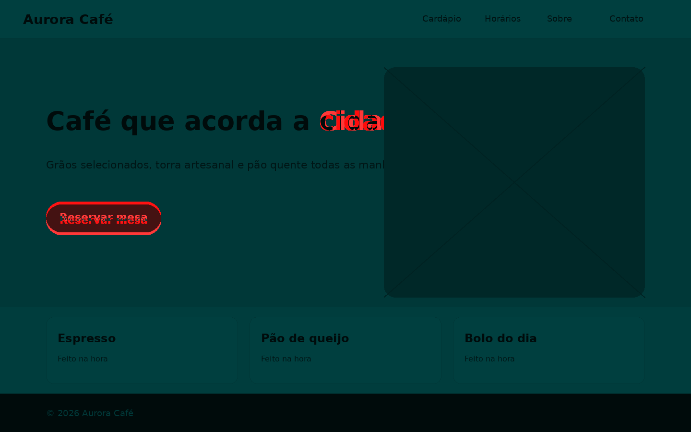
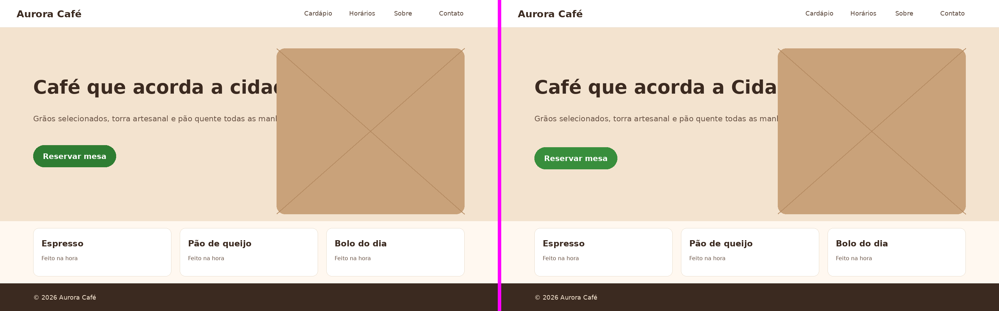
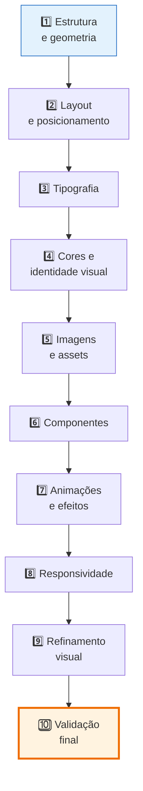
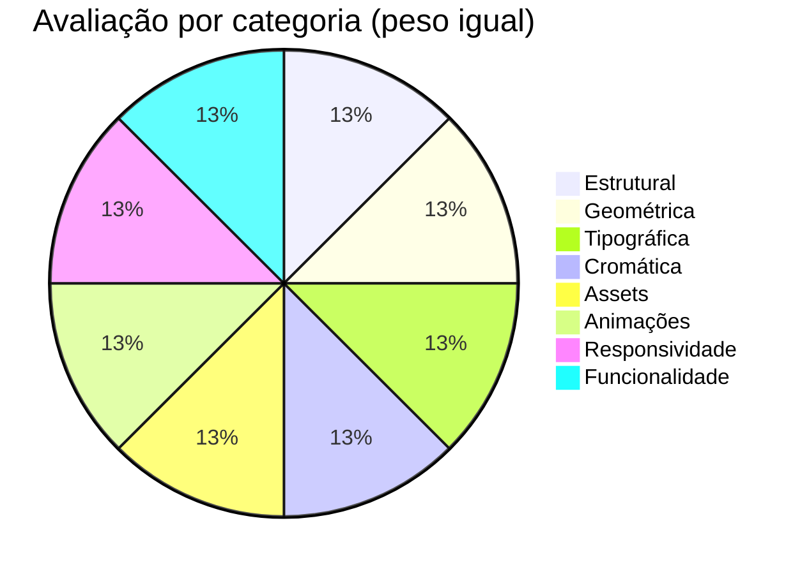

<p align="center">
  
</p>

<h1 align="center">VISUAL REFERENCE INTELLIGENCE</h1>

<p align="center">
  <strong>Engenharia reversa visual · Reprodução 1:1 · Validação pixel-perfect</strong>
</p>

<p align="center">
  <a href="https://github.com/pedrohen-lopes/VISUAL-REFERENCE-INTELLIGENCE/actions/workflows/ci.yml">
    
  </a>
  <a href="https://github.com/pedrohen-lopes/VISUAL-REFERENCE-INTELLIGENCE/blob/main/LICENSE">
    
  </a>
  <a href="https://github.com/pedrohen-lopes/VISUAL-REFERENCE-INTELLIGENCE/releases">
    
  </a>
  
  
</p>

---

## 🎯 O que é

O **VRI** transforma o Claude (Project ou Code) em um **especialista em engenharia reversa visual**. Você envia screenshots, mockups, fotos de tela ou vídeos; ele **analisa forensemente, documenta com rastreabilidade total, implementa só com sua autorização explícita e valida pixel-a-pixel**.

> **Não é um gerador de sites.** É um **reprodutor fiel**. A fidelidade à referência é o único critério de sucesso.

---

## 🔄 Fluxo completo (uma imagem vale mais que mil palavras)

```mermaid
flowchart TD
    subgraph INPUT[📥 ENTRADA]
        A[📸 Imagem / Video<br/>Screenshot, mockup, foto, vídeo]
    end

    subgraph ANALYSIS[🔬 ANÁLISE — /analisar]
        B[Fase 0: Metadados<br/>resolução, escala, viewport, tema]
        C[Fase 1: Perguntas<br/>máx 7, só o que muda o resultado]
        D[Fase 2: Forense<br/>regiões + coords, OCR literal,<br/>tipografia, cores, espaçamentos,<br/>hierarquia, inconsistências, estrutura [INFERIDA]]
    end

    subgraph SPEC[📋 ESPECIFICAÇÃO — /especificar]
        E[spec/specification.md<br/>documentação técnica completa]
        F[spec/requirements.md<br/>matriz REQ-### ↔ origem]
        G[spec/tokens.json<br/>design tokens validados]
        H[spec/regions.json<br/>regiões nomeadas [x,y,w,h]]
        I[spec/components.md<br/>inventário de componentes]
        J[spec/acceptance.md<br/>critérios de aceitação]
    end

    subgraph GATE[🤝 PORTÃO DE AUTORIZAÇÃO]
        K{Autorização explícita?<br/>"Autorizo" · "pode implementar" · /implementar}
        L[Aguardar — respostas ambíguas<br/>"ok" "legal" "continua" NÃO contam]
    end

    subgraph BUILD[🏗️ IMPLEMENTAÇÃO — /implementar]
        M[10 etapas fixas:<br/>1. Estrutura/geometria → 2. Layout → 3. Tipografia<br/>4. Cores → 5. Assets → 6. Componentes<br/>7. Animações → 8. Responsividade<br/>9. Refinamento → 10. Validação]
        N[Assets ausentes = PLACEHOLDER<br/>com dimensões exatas]
        O[Estados/animações só se evidenciados]
    end

    subgraph VALIDATE[✅ VALIDAÇÃO — /validar]
        P[Screenshot Playwright<br/>mesma resolução/escala]
        Q[Diff por região<br/>image_diff.py]
        R[Heatmap + Overlay + Side-by-side]
        S[Relatório 8 categorias<br/>status + evidências + pendências]
        T[Máx 5 ciclos de correção<br/>prioridade: Crítica→Alta→Média→Baixa]
    end

    subgraph OUTPUT[📦 ENTREGA]
        U[✅ Verificada / ⚠️ Parcial / ❌ Não verificada / 🔴 Divergente]
        V[Observado · Estimado · Implementado · Testado · Não validado · Limitações]
    end

    A --> B --> C --> D --> E & F & G & H & I & J
    E & F & G & H & I & J --> K
    K -->|Não| L
    K -->|Sim| M --> N --> O --> P --> Q --> R --> S --> T
    T -->|Divergências| Q
    T -->|Aprovado| U & V
```

---

## 🔍 O que a validação produz (artefatos reais)

| Artefato | Descrição | Exemplo |
|----------|-----------|---------|
| **Heatmap** | Vermelho = pixels divergentes (tolerância ±8/255 por canal) |  |
| **Overlay** | Referência + resultado com 50% transparência cada |  |
| **Side-by-side** | Referência \| Resultado para inspeção visual direta |  |
| **Regiões marcadas** | Áreas nomeadas com labels (A_header, B_hero, C_cards, D_footer) |  |
| **report.json** | % divergência total, por região, SSIM, bounding box das diferenças | [Ver JSON](docs/diff-example/report.json) |

> **Exemplo real:** `landing_ref.png` vs `landing_result.png` — 3 diferenças plantadas detectadas na região `B_hero` (2.34% divergente): botão 6px abaixo, verde `#388E3C` vs `#2E7D32`, "Cidade" com C maiúsculo.

---

## 📦 Duas formas de usar

```mermaid
flowchart LR
    subgraph PROJECT[🌐 Claude Web — Project]
        direction TB
        P1[1. Criar Project]
        P2[2. Colar CLAUDE_PROJECT_INSTRUCTIONS.md<br/>nas Instructions]
        P3[3. Anexar instructions/,<br/>templates/, examples/<br/>como Knowledge]
        P4[4. Usar: anexar imagem →<br/>/analisar → /especificar →<br/>autorizar → /implementar → /validar]
        P1 --> P2 --> P3 --> P4
    end

    subgraph CODE[💻 Claude Code — Local]
        direction TB
        C1[python3 tools/make_handoff.py<br/>--target ../meu-projeto]
        C2[Gera:<br/>CLAUDE.md<br/>.claude/commands/<br/>tools/ (12 scripts)<br/>spec/ (templates)<br/>references/ assets/ reports/]
        C3[Abrir Claude Code<br/>na pasta do projeto]
        C4[Usar: /analisar → /especificar →<br/>/implementar → /validar]
        C1 --> C2 --> C3 --> C4
    end

    style PROJECT fill:#e8f5e9,stroke:#2e7d32,stroke-width:2px
    style CODE fill:#e3f2fd,stroke:#1565c0,stroke-width:2px
```

### 🌐 Instalação no Claude Project (Web) — 2 min

| Passo | Ação |
|-------|------|
| 1 | Crie um **Project** novo |
| 2 | Cole `CLAUDE_PROJECT_INSTRUCTIONS.md` nas **Instructions** |
| 3 | Como **Knowledge**, anexe pastas: `instructions/`, `templates/`, `examples/` |
| 4 | (Opcional) Anexe `tools/` se seu ambiente executa Python |
| 5 | Pronto — anexe imagem e use `/analisar` |

> `tools/`, `tests/`, `claude-code-handoff/` são para uso local/repo; **não precisam ir no Project**.

### 💻 Uso com o Claude Code (Local)

```bash
# Na raiz do VRI
python3 tools/make_handoff.py --target ../meu-projeto-real
```

Gera na pasta do seu projeto:
```
meu-projeto-real/
├── CLAUDE.md                    # Regras de implementação
├── .claude/commands/            # /analisar, /especificar, /implementar, /validar
├── tools/                       # 12 scripts essenciais
├── spec/
│   ├── specification.md         # Template
│   ├── requirements.md          # Matriz REQ
│   ├── tokens.json              # Design tokens
│   ├── components.md            # Inventário
│   ├── acceptance.md            # Critérios
│   └── regions.json             # Regiões (auto se houver ref)
├── references/                  # Suas imagens aqui
├── assets/                      # Assets extraídos
└── reports/                     # Screenshots, diffs, relatórios
```

---

## 🔧 10 Etapas de implementação (ordem fixa, validada)



> Cada etapa só avança quando a anterior passa na validação visual. **Nenhum atalho.**

---

## 🏷️ Sistema de tags (rastreabilidade obrigatória)

Toda medida, cor, fonte e decisão carrega **tag + confiança**:

| Tag | Significado | Quando usar | Exemplo |
|-----|-------------|-------------|---------|
| `[OBSERVADO]` | Medido direto na imagem nítida | Imagem clara, @1x, elemento visível | `raio: 12px [OBSERVADO] ALTA` |
| `[ESTIMADO]` | Medido com margem declarada | Imagem comprimida, @2x/@3x, redimensionada | `cor: #2E7D32 [ESTIMADO] ±3 MÉDIA` |
| `[HIPÓTESE]` | Não visível, deduzido logicamente | Hover, focus, animação, estado loading | `hover: scale(1.02) [HIPÓTESE] BAIXA` |
| `[DESCONHECIDA]` | Zero evidência | Imagem estática, área cortada, fora do frame | `animação de entrada [DESCONHECIDA]` |
| `[INFERIDA]` | Estrutura técnica deduzida | HTML/JS, hierarquia de componentes, grid | `componente: Button [INFERIDA] MÉDIA` |
| `[COMPROVADA]` | Confirmada por evidência direta | DevTools, Figma, arquivo original, código-fonte | `fonte: Inter [COMPROVADA] ALTA` |

**Escala de confiança**: 🟢 **ALTA** ≥ 90% · 🟡 **MÉDIA** 60–89% · 🔴 **BAIXA** < 60%

---

## 📊 Avaliação final — 8 categorias, sem notas arbitrárias



| Status | Significado |
|--------|-------------|
| ✅ **Verificada** | Passa nos limiares de aceitação com evidência |
| ⚠️ **Parcialmente verificada** | Passa em parte, com lacunas documentadas |
| ❓ **Não verificada** | Sem evidência para validar (ex.: responsividade sem breakpoints) |
| 🔴 **Divergente** | Falha nos limiares — requer correção |

> Cada categoria traz: **evidências + pendências**. **Sem notas numéricas; sem aprovação sem validação.**

---

## 📁 Estrutura do repositório

```
VISUAL-REFERENCE-INTELLIGENCE/
├── 📄 CLAUDE_PROJECT_INSTRUCTIONS.md   # Instruções principais (Project)
├── 📄 CHANGELOG.md                      # Histórico semver
├── 📄 LICENSE                           # MIT
├── 📁 instructions/                     # 11 arquivos de conhecimento
│   ├── STANDARDS.md                     # 🔑 Fonte única: tolerâncias, gravidade, IDs, ordem
│   ├── VISUAL_ANALYSIS.md               # Procedimento forense completo
│   ├── PIXEL_PERFECT.md                 # Medição nível pixel
│   ├── MOTION_ANALYSIS.md               # Vídeo/quadro a quadro
│   ├── DESIGN_SYSTEM_EXTRACTION.md      # Tokens, componentes, padrões
│   ├── ASSET_ANALYSIS.md                # Imagens, ícones, fontes
│   ├── RESPONSIVE_ANALYSIS.md           # Breakpoints, fluidez
│   ├── IMPLEMENTATION.md                # Regras de código 1:1
│   ├── VISUAL_QA.md                     # Validação e relatório
│   ├── CORE_IDENTITY.md                 # Definições de tags/confiança
│   └── SHORTCUTS.md                     # Atalhos /analisar etc.
├── 📁 templates/                        # 7 modelos de entregáveis
├── 📁 examples/                         # Workflow completo + simulações
├── 📁 tools/                            # 15 scripts Python (ver tools/README.md)
├── 📁 claude-code-handoff/              # Pacote p/ Claude Code
│   ├── CLAUDE.md
│   └── .claude/commands/                # 4 comandos slash
├── 📁 tests/                            # Kit de testes sintéticos
│   ├── samples/                         # landing_ref, landing_result, dashboard_ref
│   ├── ground_truth.json                # Gabarito exato
│   ├── run_tool_checks.py               # Autoteste (10 checks)
│   └── TEST_KIT.md                      # 8 prompts de teste P1–P8
└── 📁 docs/                             # Assets visuais p/ README
    └── diff-example/                    # Heatmap, overlay, side-by-side reais
```

---

## 🧪 Testar

| Ambiente | Comando | O que valida |
|----------|---------|--------------|
| **PC (local)** | `python3 tests/run_tool_checks.py` | 10 scripts contra imagens sintéticas + gabarito |
| **Claude Project** | Prompts P1–P8 de `tests/TEST_KIT.md` com `tests/samples/` | Comportamento do VRI instalado |

```bash
# Resultado esperado (CI verde):
[PASS] image_info detecta viewport 1920 @1x
[PASS] sample_colors lê a cor da imagem do hero
[PASS] image_diff localiza a diferença na região B_hero
[PASS] image_diff não acusa regiões sem diferença
[PASS] image_diff gera heatmap, overlay e lado a lado
[PASS] validate_tokens aprova o template
[PASS] validate_tokens reprova tag e HEX inválidos
[PASS] crop_regions recorta 240x64
[SKIP] ocr_text  - tesseract ausente
[SKIP] screenshot  - Playwright/Chromium indisponível

10 ok/ignorados, 0 falha(s).
```

---

## ⚠️ Limitações (sempre declaradas)

- **Validação automática** exige navegador (Playwright/Chromium); sem isso → checklist manual, **não declara conformidade**
- **Cores/medidas** de imagens comprimidas são **estimativas**; fontes identificadas por **semelhança**
- **Fotos, ilustrações, 3D, Lottie** exigem **arquivos originais**
- **Estados/animações não visíveis** = hipóteses ou desconhecidos
- Testado em **Linux + Python 3.12**; Android/Termux pode precisar passos extras para Pillow/numpy

---

## 🤝 Contribuindo

1. Fork → branch → PR
2. `python3 tests/run_tool_checks.py` deve passar
3. CI roda automaticamente (tesseract + Playwright no runner)
4. Documentação visual em `docs/` se mudar outputs de diff

---

## 📄 Licença

MIT — veja `LICENSE`. Livre para uso comercial, modificação, distribuição.

---

<p align="center">
  <sub>Feito com <strong>engenharia reversa honesta</strong> — reproduz o que vê, não o que imagina.</sub>
</p>