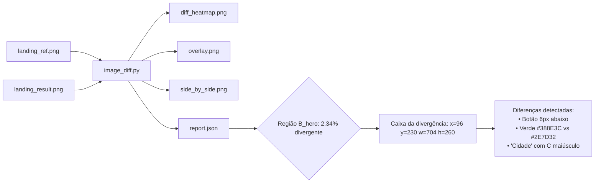
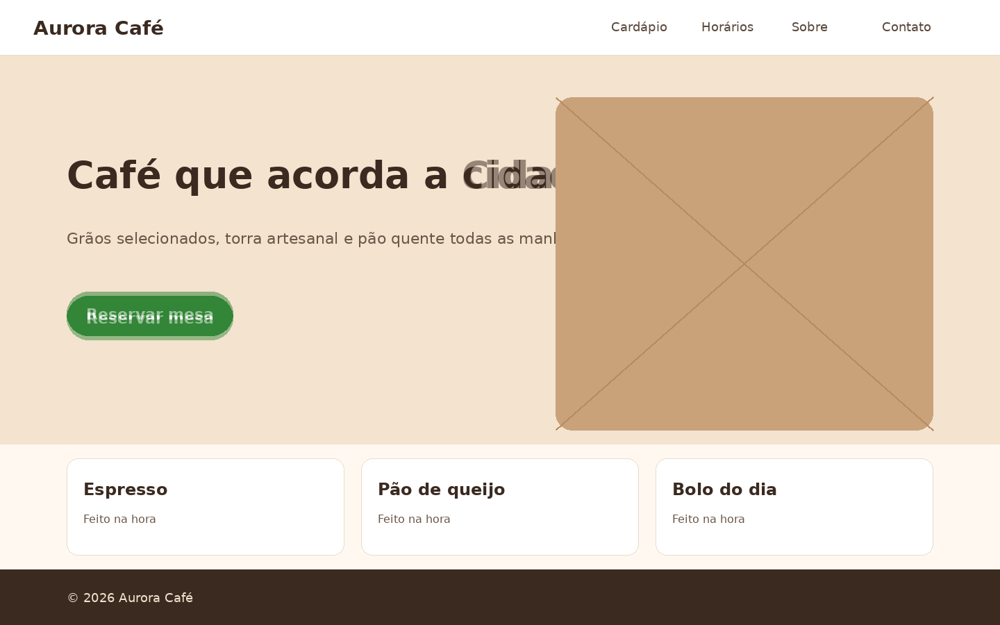
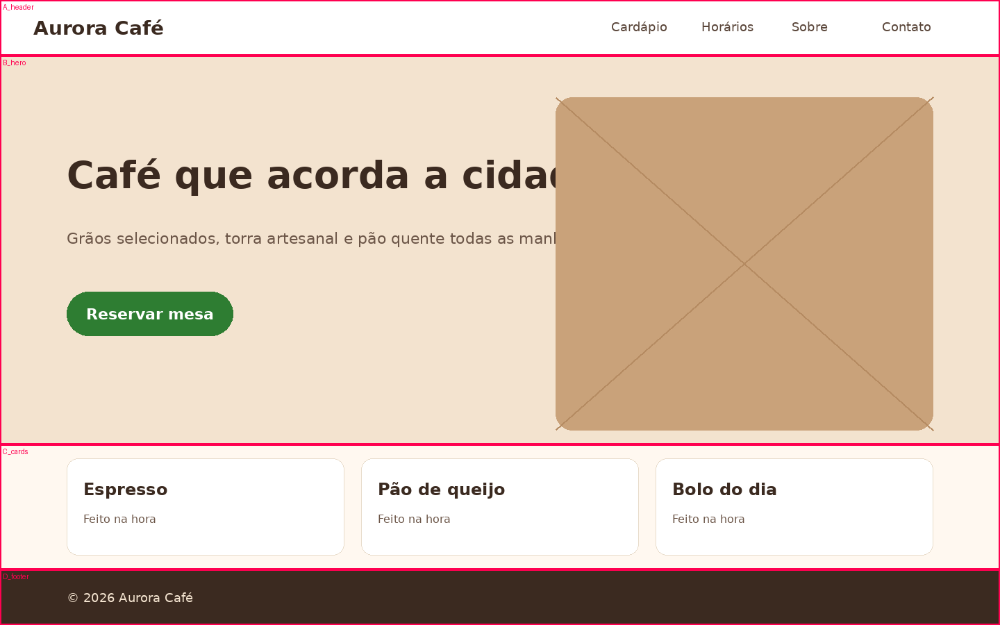
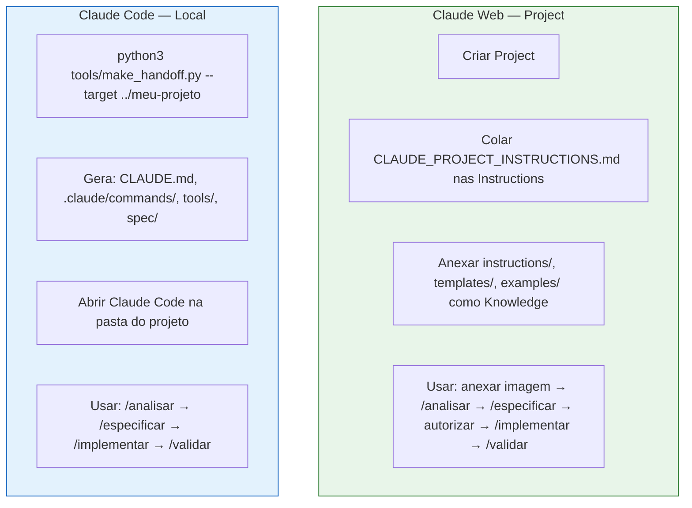
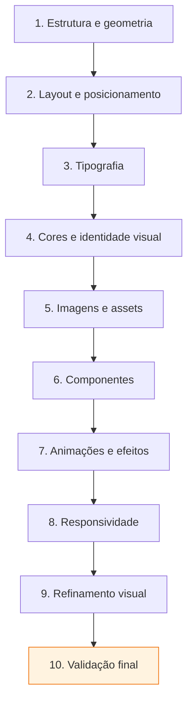
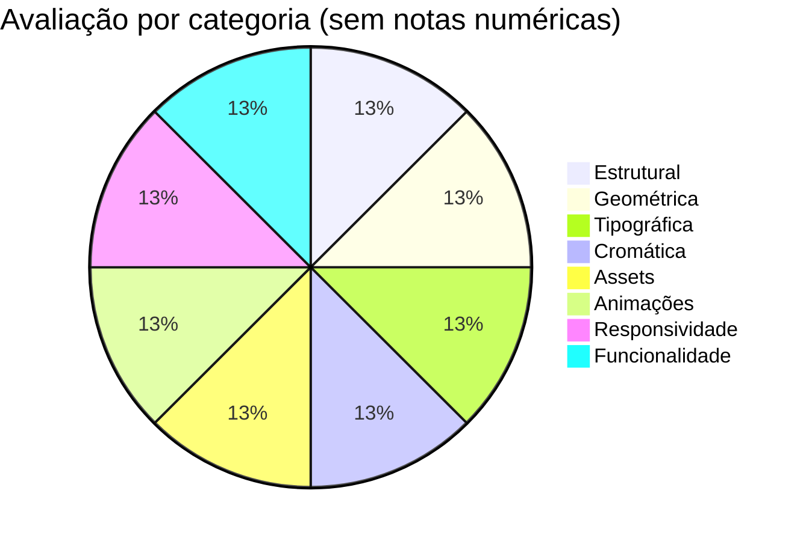

# VISUAL REFERENCE INTELLIGENCE

Kit para configurar um **Claude Project** especializado em engenharia reversa visual e reprodução de interfaces 1:1, com scripts de apoio, pacote de entrega para o Claude Code e kit de testes. Você envia imagens, screenshots e vídeos; o Claude analisa, documenta e, **só com sua autorização**, implementa e valida.

Versão: ver `CHANGELOG.md` · Licença: MIT


## 🎯 O que ele faz (em 1 diagrama)

```mermaid
flowchart TD
    A[📸 Você envia imagem/video] --> B[/analisar]
    B --> C[Análise forense: regiões, OCR, cores, tipografia, espaçamentos, estrutura]
    C --> D[/especificar]
    D --> E[Gera spec/: specification.md, requirements.md, tokens.json, regions.json]
    E --> F{🤝 Autorização explícita?}
    F -->|Não| G[Aguardar "Autorizo" / "pode implementar" / /implementar]
    F -->|Sim| H[/implementar]
    H --> I[Implementa em 10 etapas: estrutura → layout → tipografia → cores → assets → componentes → animações → responsividade → refinamento → validação]
    I --> J[/validar]
    J --> K[Screenshot Playwright + Diff por região + Heatmap + Overlay + Side-by-side]
    K --> L[Relatório por categoria: estrutural, geométrica, tipográfica, cromática, assets, animações, responsividade, funcionalidade]
    L --> M{✅ Aprovado?}
    M -->|Divergências| N[Corrige prioridade: Crítica → Alta → Média → Baixa<br/>Máx 5 ciclos]
    M -->|Sim| O[🎉 Entregue: observado · estimado · implementado · testado · não validado · limitações]
    N --> J
```

## 🔍 O que a validação produz

| Saída | Descrição |
|-------|-----------|
| **Heatmap** | Vermelho = pixels divergentes (tolerância ±8/255 por canal) |
| **Overlay** | Referência + resultado 50% transparência |
| **Side-by-side** | Referência \| Resultado para inspeção visual |
| **report.json** | % divergência total, por região, SSIM, bounding box das diferenças |

### Exemplo real (landing_ref.png vs landing_result.png — 3 diferenças plantadas)



#### Saídas visuais geradas

| Heatmap (vermelho = divergência) | Overlay (50% ref + 50% resultado) | Side-by-side |
|:---:|:---:|:---:|
|  |  |  |

#### Regiões marcadas



## Estrutura
| Pasta/arquivo | Função |
|---|---|
| `CLAUDE_PROJECT_INSTRUCTIONS.md` | Instruções principais (copiar e colar no Project). Enxutas: regras de ouro, fluxo, portão de autorização. |
| `instructions/` | Base de conhecimento: `STANDARDS` (números e definições), `SHORTCUTS`, `CORE_IDENTITY`, `VISUAL_ANALYSIS`, `PIXEL_PERFECT`, `MOTION_ANALYSIS`, `DESIGN_SYSTEM_EXTRACTION`, `ASSET_ANALYSIS`, `RESPONSIVE_ANALYSIS`, `IMPLEMENTATION`, `VISUAL_QA`. |
| `templates/` | Modelos dos entregáveis (análise, especificação, tokens JSON, inventário, prompt, critérios, relatório). |
| `examples/` | `EXAMPLE_WORKFLOW` (sessão completa) e `SIMULATIONS` (revisão e simulações). |
| `tools/` | Scripts Python de apoio (veja `tools/README.md`). |
| `claude-code-handoff/` | Pacote para o Claude Code: `CLAUDE.md` e comandos `/analisar`, `/especificar`, `/implementar`, `/validar`. |
| `tests/` | Imagens sintéticas com gabarito, autoteste e prompts de teste (veja `tests/TEST_KIT.md`). |

## 📦 Duas formas de usar



### Instalação no Claude Project (Web)
1. Crie um **Project** e cole `CLAUDE_PROJECT_INSTRUCTIONS.md` nas **Instructions**
2. Como **Knowledge**, anexe: `instructions/`, `templates/`, `examples/`
3. (Opcional) Anexe `tools/` se seu ambiente executar Python
4. Use: anexe imagem → `/analisar` → `/especificar` → **autorize explicitamente** → `/implementar` → `/validar`

> `tools/`, `tests/`, `claude-code-handoff/` são para uso local/repo; **não** precisam ir no Project.

### Uso com o Claude Code (Local)
```bash
python3 tools/make_handoff.py --target ../meu-projeto
```
Gera na pasta do seu projeto:
- `CLAUDE.md` — regras de implementação
- `.claude/commands/` — `/analisar`, `/especificar`, `/implementar`, `/validar`
- `tools/` — 12 scripts essenciais
- `spec/` — templates prontos (specification.md, tokens.json, etc.)
- `references/`, `assets/`, `reports/` — pastas de trabalho

Detalhes em `claude-code-handoff/README.md`.

## Fluxo recomendado (igual nos dois)
`/analisar` → responder perguntas → `/especificar` → **autorizar explicitamente** (`/implementar`) → `/validar`. **Nada é programado sem autorização válida.**

## 🔧 10 Etapas de implementação (ordem fixa)



Cada etapa só avança quando a anterior passa na validação visual.

## 🏷️ Sistema de tags (rastreabilidade obrigatória)

| Tag | Quando usar | Exemplo |
|-----|-------------|---------|
| `[OBSERVADO]` | Medido direto na imagem nítida | `raio: 12px [OBSERVADO] ALTA` |
| `[ESTIMADO]` | Medido com margem (imagem comprimida/@2x) | `cor: #2E7D32 [ESTIMADO] ±3 MÉDIA` |
| `[HIPÓTESE]` | Não visível, deduzido (hover, animação) | `hover: scale(1.02) [HIPÓTESE] BAIXA` |
| `[DESCONHECIDA]` | Sem evidência nenhuma (imagem estática) | `animação de entrada [DESCONHECIDA]` |
| `[INFERIDA]` | Estrutura técnica deduzida (HTML/JS) | `componente: Button [INFERIDA] MÉDIA` |
| `[COMPROVADA]` | Confirmada por evidência direta (DevTools, Figma, código) | `fonte: Inter [COMPROVADA] ALTA` |

**Confiança**: ALTA ≥ 90% · MÉDIA 60–89% · BAIXA < 60%

## 📊 Categorias de avaliação final



Status por categoria: **Verificada** · **Parcialmente verificada** · **Não verificada** · **Divergente**  
Cada uma traz: evidências + pendências. **Sem notas arbitrárias; sem aprovação sem validação.**

## Testar
No PC: `python3 tests/run_tool_checks.py`. No Project: prompts P1–P8 de `tests/TEST_KIT.md` com as imagens de `tests/samples/`.

## Limitações
- A validação visual automática exige ambiente com navegador (Claude Code ou ferramenta de código); sem isso o Claude entrega checklist manual e não declara conformidade.
- Cores e medidas de imagens comprimidas são estimativas; fontes são identificadas por semelhança.
- Fotos, ilustrações, 3D e Lottie exigem os arquivos originais.
- Estados e animações não visíveis são hipóteses ou desconhecidos.
- Os scripts foram testados em Linux com Python 3.12; no Android/Termux a instalação de Pillow/numpy pode exigir passos extras (use o PC se falhar).
